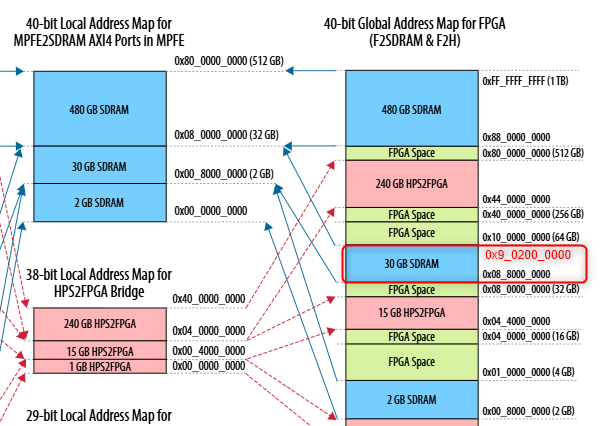

# HPS Time-Sensitive Network (RGMII from HVIO) System Example Design for Agilex 5 FPGA and SoC C-Series Development Kit

Time-Sensitive Networking (TSN): PHY configuration 2 (RGMII from FPGA HVIO) Baseline Hardware Reference Design for Agilex 5 FPGA and SoC C-Series Development Kit.

> **Note:** This design is not fully validated yet for this release.

## Description

<p>This design is a Baseline Hardware Reference Design for Altera Agilex 5 System On Chip (SoC) FPGA.

</p><p>The design is part of the Baseline System Example Design, which provides a complete solution, including exercising soft IP in the fabric, booting to U-Boot, then Linux, and running sample Linux applications.
Refer to the <a href=\"https://altera-fpga.github.io/latest/embedded-designs/agilex-5/e-series/premium/gsrd/ug-gsrd-agx5e-premium/\">HPS Baseline System Example Design User Guide for the Agilex 5 E-Series Development Kit</a> for more information.

</p><p>The design uses HPS First configuration mode.

</p><h2>Time-Sensitive Networking (TSN): PHY configuration 2 (RGMII from FPGA HVIO) feature
</h2><p>This design demonstrates the following system integration between Hard Processor System (HPS) and FPGA IPs:
<ul><li>Hard Processor System (HPS) enablement and configuration
<ul><li>Enable dual core Arm Cortex-A55 processor
</li><li>HPS Peripheral and I/O (SD/MMC, EMAC, MDIO, USB, I2C, I3C, JTAG, UART, and GPIO)
</li><li>HPS Clock and Reset
</li><li>HPS FPGA Bridge and Interrupt
<ul><li>Note: The System MMU port in F2SDRAM bridge is disabled by default</li></ul>
</li></ul><li>HPS EMIF configuration (Inline ECC for LPDDR4 is disabled by default)
</li><li>System integration with FPGA IPs
<ul><li>GMII to RGMII Converter IP to handle conversion for HPS EMAC into FPGA HVIO interface.
</li><li>Fabric subsystem that consists of NiosV subsystem, 256KB of FPGA On-Chip Memory, System ID, Programmable I/O (PIO) IP for PushButton, and LEDs.
</li><li>NiosV subsystem that consists of JTAG Avalon Master Bridge IP and Address Span Extender IP to allow System-Console debug activity and FPGA content access through JTAG.
</li></ul></li></ul></p>

<h2>Advanced feature
</h2><p>FPGA RGMII subsystem that consists of GMII-to-RGMII conversion for HPS EMAC into FPGA IO connection</p>

## Project Details

- **Family**: Agilex 5
- **Quartus Version**: 26.3
- **Development Kit**: Agilex 5 FPGA E-Series 013B Development Kit DK-A5E013BM16AEA
- **Device Part**: A5ED013BM16AE4SCS
- **Category**: HPS
- **Source**: Quartus Prime Pro
- **URL**: https://github.com/altera-fpga/agilex5-ed-hps-baseline
- **Design Package**: dk-a5e013bm16aea-tsn-dc-tsn-rgmii-hvio.zip
- **Documentations**: https://altera-fpga.github.io/latest/embedded-designs/agilex-5/e-series/013B/gsrd/ug-gsrd-agx5e-013b/

## Documentations

- **Title**: HPS Baseline System Example Design User Guide: Agilex 5 FPGA E-Series 013B Development Kit
**URL**: https://altera-fpga.github.io/latest/embedded-designs/agilex-5/e-series/013B/gsrd/ug-gsrd-agx5e-013b/

## Software projects

| Project | Description |
|---------|-------------|
| [Yocto Linux](software/yocto_linux/README.md) | Linux BSP build, boot, and Simics bring-up |
| [HPS debug](software/hps_debug/README.md) | HPS content wipe utility for debug |

## Design overview
Note for *USB3.1:
Agilex 5 Hard Processor System supports USB3.1.
However, Agilex 5 FPGA and SoC C-Series Development Kit does not have transceiver (XCVR) for USB3.1.
Therefore, the board only supports USB 2.0 ULPI interface via USB 3.1 controller.


## Hard Processor System (HPS)
This design's HPS configuration matches the board schematic.
Refer to [Hard Processor System Technical Reference Manual: Agilex 5 SoCs](https://docs.altera.com/r/docs/814346/current) and [Hard Processor System Component Reference Manual: Agilex 5 SoCs](https://docs.altera.com/r/docs/813752/current) for more information on HPS configuration.

## HPS External Memory Interfaces (EMIF)
The design HPS EMIF configuration matches the board schematic.
Refer to [External Memory Interfaces (EMIF) IP User Guide: Agilex 5 FPGAs and SoCs](https://docs.altera.com/r/docs/817467/current) for more information on HPS EMIF configuration.

## Bridges
Bridges are used to move data between FPGA fabric and HPS logic.
Refer to [HPS Bridges](https://docs.altera.com/r/docs/813752/26.3/hard-processor-system-component-reference-manual-agilex-5-socs/fpga-bridges)

The HPS address map and the FPGA address map are the same for Agilex 5.
Refer to [Total Address Map Graphical](https://docs.altera.com/r/docs/814346/26.3/hard-processor-system-technical-reference-manual-agilex-5-socs/total-address-map-graphical) for more information.

Therefore, when accessing HPS logic in uboot or linux, the base address would be the same as, when using [Debug Subsystem](#Debug-Subsystem) from FPGA fabric.

| Bridge   | Use Case |
| :-- | :-- |
| F2SDRAM  | move data from FPGA fabric to HPS logic (non-coherent). Can access HPS EMIF. |
| LWH2F    | move data from HPS logic to FPGA fabric. Access FPGA peripherial Control Status Register (CSR). |
| H2F      | move data from HPS logic to FPGA fabric. Access FPGA Onchip Memory as scratch pad.    |

## Fabric Subsystem

### NiosV Subsystem
The JTAG UART IP interface allows access to the peripherals in the FPGA with System Console, through the JTAG UART IP module. This access does not rely on HPS software drivers.

Refer to this [Guide](https://docs.altera.com/r/docs/683819/26.3/quartus-prime-pro-edition-user-guide/analyzing-and-debugging-designs-with-system-console) for information about system console.

| NiosV                                | Attribute                    | Addresss Offset                           | Size (bytes)     |
|:-------------------------------------|------------------------------|-------------------------------------------|:----------------:|
| ocm                                  |  On-Chip Memory II           | 0x0                                       | 262144           |
| jtag_uart                            |  JTAG UART                   | 0x0005_0040                               | 8                |
| f2sdram_address_<br>span_extender    | Address Span Extender        | 0x0005_0080 (cntl)<br>0x8000_0000 (slave) | 8<br>1073741824  |
| pio_in                               | PIO (Parallel I/O) Inputs    | 0x0005_0050                               | 16               |
| pio_out                              | PIO (Parallel I/O) Outputs   | 0x0005_0060                               | 16               |


### SDRAM Access via Address Span Extender (F2SDRAM Bridge)

#### Overview

The PDK is equipped with **8 GB of SDRAM**, mapped across two physical address regions:

| Region       | Global Address Range                 | Local Address Range                     |
|--------------|--------------------------------------|-------------------------------------------|
| Lower 2 GB   | `0x00_8000_0000` – `0x00_FFFF_FFFF`  | `0x0_0000_0000` – `0x0_7FFF_FFFF`        |
| Upper 6 GB   | `0x08_8000_0000` – `0x09_FFFF_FFFF`   | `0x0_8000_0000` – `0x1_FFFF_FFFF`        |

> **

> **Note:** System Console/Nios V operates in a **32-bit address space** and cannot directly access 64-bit SDRAM addresses. The address `0x9_0200_0000` is an example of a target address in the upper 6GB region.

---

#### Address Span Extender IP

The **Address Span Extender IP (F2SDRAM Bridge)** resolves this limitation by using two control registers — **CSR_L** and **CSR_H** — to construct a full 64-bit physical SDRAM address from a 32-bit data address.

| Register | Base Address          | Holds                                   |
|----------|-----------------------|-----------------------------------------|
| `CSR_L`  | `0x50080`(F2SDRAM)    | Bits `[31:0]` of 64-bit target address  |
| `CSR_H`  | `0x50084`(F2SDRAM)    | Bits `[63:32]` of 64-bit target address |

Together, **CSR_H** and **CSR_L** define the physical SDRAM region that the 32-bit data address window points to.

#### How the Address Span Extender Works — The "Sliding Window" Concept

Think of the Address Span Extender like a **sliding window** cut into a wall:

- The **wall** represents the full 8 GB SDRAM — too large to see all at once.
- The **window** is a fixed **1 GB opening** (`0x0` to `0x4000_0000` in internal offset) that you can look through at any one time.
- The **CSR registers** are the handle you use to **slide the window** to point at any part of the 8 GB SDRAM.

In this design, the 1 GB window (windowed_slave) is placed at address from `0x8000_0000` to `0xbfff_ffff` (F2SDRAM) in the address_span_extender IP, covering exactly 2²⁸ × 4 = **1 GB** of addressable space through a 28-bit word address.

#### Sliding the Window — When to Shift CSR_L

For F2SDRAM as example, `CSR_L` is set to `0x8000_0000`, which anchors the window at `0x8000_0000` and allows System Console to read addresses from `0x8000_0000` to `0xBFFF_FFFF`. If your target SDRAM address exceeds this 1 GB window (i.e. the lower 32 bits of your target address is greater than `0xBFFF_FFFF`), you need to **slide the window** by updating `CSR_L` to the next 1 GB aligned boundary. Set `CSR_L` to `0xC000_0000`, which shifts the window to cover `0xC000_0000` to `0xFFFF_FFFF`. The System Console read address then starts from `0xC000_0000` onwards for that new window.

---

#### How to Perform a Read via System Console

**Step 1 — Set the CSR registers** before reading:
- Write the **lower 32 bits** of the target SDRAM address to `CSR_L` at `0x50080` (F2SDRAM).
- Write the **upper 32 bits** of the target SDRAM address to `CSR_H` at `0x50084` (F2SDRAM).

**Step 2 — Compute the data address:**

Compute_address = F2SDRAM Address Span Extender IP window slave address (0x8000_0000) + offset from target address

**Step 3 — Read from the computed data address** in System Console.

---

#### Example Target Address

> **
> *Figure 1: F2SDRAM Lower 2GB Example*

| Target Address | CSR_H | CSR_L       | F2SDRAM address span extender window slave address + offset |
|----------------|-------|-------------|-------------------------------------------------------------|
| 0xC200_0000    | 0x0   | 0xC000_0000 | 0x8000_0000 (f2sdram) + 0x0200_0000 = 0x8200_0000           |

> **
> *Figure 2: F2SDRAM Upper 6GB Example*

| Target Address | CSR_H | CSR_L       | F2SDRAM address span extender window slave address + offset |
|----------------|-------|-------------|-------------------------------------------------------------|
| 0x9_0200_0000  | 0x9   | 0x0000_0000 | 0x8000_0000 (f2sdram) + 0x0200_0000 = 0x8200_0000           |

---

#### Key Takeaway

> The **System Console input address (master_address)** is always derived from the **base address of the Address Span Extender IP window** plus the **offset extracted from the lower 32 bits of the target address**, regardless of which SDRAM region you are accessing.

> In summary: **`CSR_H` selects the SDRAM bank, `CSR_L` slides the window within that bank, and the master_address is always base_address + offset from the target address.**

## Peripheral
| Peripheral | Address Offset | Size (bytes) | Attribute | Interrupt Number
| :-- | :-- | :-- | :-- | :-- |
| interval_timer | 0x0000_0000 | 32 | Interval timer | 1 |
| interrupt_latency_counter | 0x0000_0100 | 256 | Measures interval timer interrupt latency | None |
| sysid | 0x0001_0000 | 8 | Unique system ID   | None |
| led_pio | 0x0001_0080 | 16 | LED outputs   | None |
| button_pio | 0x0001_0060 | 16 | Push button inputs | 0 |

### Notes
- There are 1 user push-button inputs and 2 LED outputs that is connected to fpga pins on Agilex 5 FPGA and SoC C-Series Development Kit.
  -  Only the lower bit of LED outputs are available for software to control. The most significant bit of the LED is used in the design top module as heartbeat led. This LED blinks when the fpga design is loaded. Users will not be able to control this LED with HPS software, for example U-Boot or Linux.
- The peripheral is accessed via the LWH2F bridge and has an offset of 0x0_2000_0000. Refer to [Total Address Map Graphicals](https://docs.altera.com/r/docs/814346/26.3/hard-processor-system-technical-reference-manual-agilex-5-socs/total-address-map-graphical) for more information.
- The FPGA IRQ has offset of 17 when mapped to Generic Interrupt Controller (GIC) in device tree structure(dts). Refer to [GIC Shared Peripheral Interrupts Map for the SoC HPS](https://docs.altera.com/r/docs/814346/26.3/hard-processor-system-technical-reference-manual-agilex-5-socs/gic-shared-peripheral-interrupts-map-for-the-soc-hps)

## Hardware build
**Prerequisites**
- Altera Quartus Prime 26.3
- Python 3.11.5 (only required when using command line to build)

### Using Quartus GUI
1. Launch Quartus Prime 26.3
2. Open the design project. E.g top.qpf.
3. Click the play button to compile the design.
4. The compiled sof can be found in output_files folder of the project path.

### Using Command Line
1. Build the design sof
```bash
make tsn-rgmii-hvio-build
```
After build, the bitstream (sof) can be found in output_files folder.

2. Use the following command to generate the core.rbf (optional)
```bash
make tsn-rgmii-hvio-install-core-rbf
```
The generated core.rbf can be found in install/binaries folder.

# Yocto Build Setup Guide
1. Refer to [Yocto Linux Build Instructions](software/yocto_linux/README.md#yocto-build) file and follow the steps to build Yocto.

After build, the binaries can be found in the software/yocto_linux_sd or software/yocto_linux_qspi folder.

# HPS Debug Program
Refer to the [README](software/hps_debug/README.md) file and follow the steps to build the HPS content wipe program.