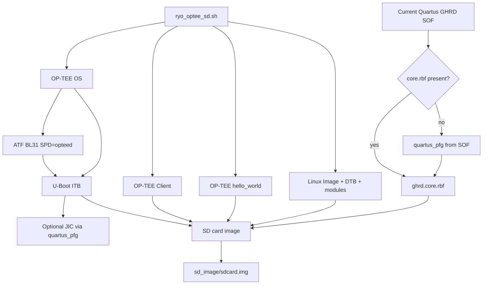

# Agilex 5 OP-TEE RYO Example (SD boot)

Roll-your-own (RYO) OP-TEE enablement for the **Agilex 5 FPGA E-Series 013B**
development kit (`DK-A5E013BM16AEA`), shipped under the HPS Baseline-A55 GSRD:

[`dk-a5e013bm16aea/baseline-a55/software/ryo_optee`](https://github.com/altera-fpga/agilex5e-ed-gsrd/tree/QPDS26.1.1_REL_GSRD_PR/dk-a5e013bm16aea/baseline-a55/software/ryo_optee)

This example builds a full HPS boot chain with OP-TEE, packages an SD card image,
and installs the `hello_world` Trusted Application (TA) plus host binary.

## What you get

| Component | Role |
|-----------|------|
| OP-TEE OS | Trusted Execution Environment (`tee-pager_v2.bin`) |
| OP-TEE Client | `libteec` + `tee-supplicant` |
| OP-TEE Examples | `optee_example_hello_world` + TA |
| Arm Trusted Firmware | BL31 with `SPD=opteed` |
| U-Boot | Loads OP-TEE + BL31 FIT; OP-TEE firewall / firmware patches |
| Linux | OP-TEE driver + Agilex5 DTB patches |
| FPGA | Current-design SOF + `ghrd.core.rbf` (not old rocketboards binaries) |
| SD image | FAT boot + ext3 rootfs with OP-TEE userspace |

## Build flow



Component order inside the script:

1. OP-TEE OS → Client → `hello_world`
2. ATF (BL31 + OPTEED)
3. U-Boot (consumes BL31 + TEE binary)
4. Linux kernel + DTB + modules
5. Resolve SOF / `core.rbf` from **current design**
6. Optional JIC
7. SD image + OP-TEE userspace install

## Prerequisites

- Ubuntu (or similar) build host with common build tools (`git`, `make`, `cmake`, `wget`, …)
- Network access to clone the pinned git sources
- Quartus Prime Pro matching this GSRD (e.g. **26.1.1**) with `quartus_pfg` in `PATH` when:
  - generating `ghrd.core.rbf` from SOF, and/or
  - building the optional JIC
- A SOF built from the **current** `baseline-a55` design with that Quartus version

The script downloads an AArch64 GNU toolchain automatically if `gcc-arm/` is absent.

## Pinned sources (reproducible)

Defaults match the QPDS26.1.1 GSRD `kas/bsp.yml` pins where applicable.
Override with `*_REPO` / `*_REF` if needed.

| Tree | Default repo | Default ref |
|------|--------------|-------------|
| OP-TEE OS | `https://github.com/altera-fpga/optee_os.git` | tag `socfpga_v26.1.1_optee` |
| OP-TEE Client | `https://github.com/OP-TEE/optee_client.git` | tag `4.5.0` |
| OP-TEE Examples | `https://github.com/altera-fpga/optee_examples.git` | tag `socfpga_v26.1.1_optee` |
| ATF | `https://github.com/altera-fpga/arm-trusted-firmware.git` | commit `2ea5afda7f34…` (`socfpga_v2.14.1`) + local OP-TEE patch |
| U-Boot | `https://github.com/altera-fpga/u-boot-socfpga.git` | commit `e09d6fcc95f3…` (`socfpga_v2026.04`) |
| Linux | `https://github.com/altera-fpga/linux-socfpga.git` | commit `d8e46bd82a1e…` (`socfpga-6.18.20-lts`) |

OP-TEE OS / examples are under `altera-fpga` at tag `socfpga_v26.1.1_optee`
(branch `socfpga_agilex5_optee`).

## Build

From this directory (or the same path inside the GSRD tree):

```bash
# 1) Build / locate current-design SOF (required)
#    Typical after Quartus compile of baseline-a55:
#      ../../output_files/ghrd_a5ed013bm16ae4scs.sof
#    or copy the SOF next to this script.

# 2) Optional: provide core.rbf from the same design; otherwise the script
#    generates it from the SOF with quartus_pfg.
export GHRD_SOF=/path/to/ghrd_a5ed013bm16ae4scs.sof
# export GHRD_RBF=/path/to/ghrd.core.rbf

# 3) Build everything
./ryo_optee_sd.sh

# Useful flags / env
#   --skip-jic / SKIP_JIC=1
#   --skip-sd-image / SKIP_SD_IMAGE=1
#   --jobs=N / JOBS=N
```

Clean rebuild (from the GSRD tree copy):

```bash
./clean_build.sh
./ryo_optee_sd.sh
```

### Important FPGA policy

- **Do not** download the older rocketboards SOF / `ghrd.core.rbf`.
- Use the SOF from the **current** design + **current** Quartus.
- Use the matching `core.rbf`, or let the script rebuild it from that SOF.

Rootfs tarball still comes from the GSRD release area (`gsrd-console-image-agilex5.tar.gz`)
and is separate from the SOF/RBF rule above.

## Run on board

1. Write the SD image:

   ```bash
   sudo dd if=sd_image/sdcard.img of=/dev/sdX bs=4M status=progress conv=fsync
   ```

2. Boot `DK-A5E013BM16AEA` from SD (HPS first / SD boot as for the baseline GSRD).

3. On the Linux console:

   ```bash
   # tee-supplicant is started by the installed init/systemd unit
   optee_example_hello_world
   ```

Expected: host app talks to the TA through OP-TEE and prints the hello_world success path.

Optional QSPI programming uses `ghrd_sd.hps.jic` when JIC generation was not skipped.

## Patches in this example

All five patches are kept and applied by the build script:

| Patch | Component | Why keep |
|-------|-----------|----------|
| `0001-feat-intel-initial-optee-enablement_atf.patch` | ATF | Agilex5 OP-TEE plat enablement is **not** in published `altera-fpga` ATF (`socfpga_v2.14.x` or latest `socfpga_v2.15.0`). Drop only after that commit is merged. |
| `0001-…firewall_uboot.patch` / `0002-…firmware-in-_uboot.patch` | U-Boot | OP-TEE SDRAM firewall + loadable TEE firmware |
| `0001-…agilex5_linux.patch` / `0002-…013b-_linux.patch` | Linux | OP-TEE + 013B DTB enablement |

## Layout

```text
ryo_optee/
  README.md                 # this file
  ryo_optee_sd.sh           # one-shot builder
  clean_build.sh            # remove build trees / artifacts
  patches/                  # ATF + U-Boot + Linux OP-TEE patches
```

## Upstream package path

Intended landing path in the GSRD repo:

https://github.com/altera-fpga/agilex5e-ed-gsrd/tree/QPDS26.1.1_REL_GSRD_PR/dk-a5e013bm16aea/baseline-a55/software/ryo_optee
