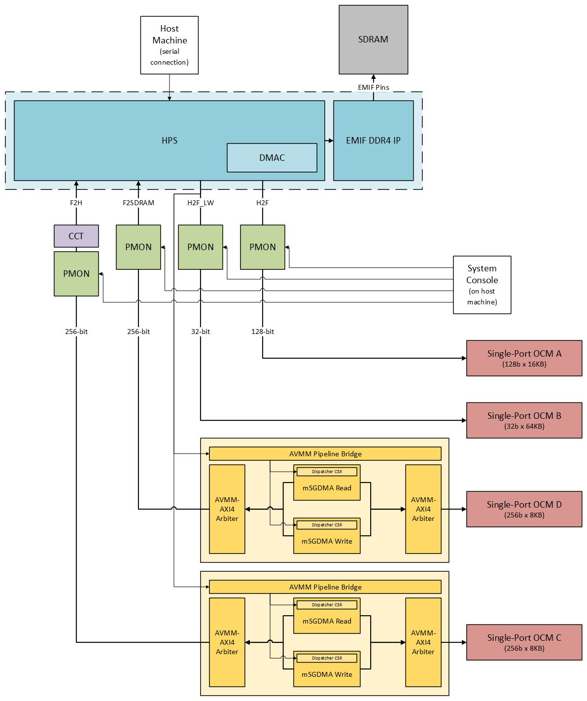

# Data Mover System Example Design for Agilex 5 FPGA E-Series 065A Premium Development Kit

This is the Data Mover System Example Design for Agilex 5 FPGA E-Series 065A Premium Development Kit with Out of Box Experience (OOBE) daughter card, which is also known as HPS Enablement Expansion Board.

## Description

The Data Mover System Example Design is based on the Quartus Design for Agilex 5 FPGA E-Series 065A Premium Development Kit with Out of Box Experience (OOBE) daughter card. It showcases data transactions among FPGA fabric, HPS, and external memory. This embedded system incorporates all data channels between the FPGA fabric and the HPS (F2H, F2SDRAM, H2F, and LWH2F) and uses a software benchmark program to highlight performance metrics for different data flows.

The design uses HPS First configuration mode and boots from Arm Cortex-A55 core processor.

## Project Details

- **Family**: Agilex 5 E-Series
- **Quartus Version**: 26.1.1
- **Development Kit**: Agilex 5 FPGA E-Series 065A Premium Development Kit DK-A5E065AB32AEA
- **Device Part**: A5ED065AB32AE1V
- **Category**: HPS
- **Source**: Quartus Prime Pro
- **URL**: https://www.github.com/altera-fpga/agilex5e-ed-gsrd
- **Design Package**: dk-a5e065ab32aea-enablement-datamover.zip
- **Documentations**: https://docs.altera.com/r/example-designs/gg00091/current

## Documentations

- **Title**: Data Mover Documentation for the Agilex 5 E-Series Premium Development Kit
**URL**: https://docs.altera.com/r/example-designs/gg00091/current
- **Title**: Data Mover System Example Design README for the Agilex 5 E-Series Premium Development Kit
**URL**: https://github.com/altera-fpga/agilex5e-ed-gsrd/blob/main/dk-a5e065ab32aea-enablement/datamover/README.md

# Data Mover Overview

Proceeding parts of this document will highlight the most crucial components of the Data Mover design. More specific information can be found in the [Data Mover User Guide](https://docs.altera.com/r/example-designs/gg00091/current).

## HPS IP

The HPS controls all data transaction functionalities, including DMA operations, QoS generation, EMIF data transfer, and the general execution of FreeRTOS. In this design, the F2H bridge MMU port setting of this IP is enabled so that F2H transactions will go through the SMMU for cache-coherent transactions. All other parameters are the same as the HPS IP in the HPS Baseline System Example Design.

## mSGDMA IP and AVMM Arbiter

The data mover design uses Modular Scatter-Gather Direct-Memory-Access (mSGDMA) IPs to facilitate F2H and F2SDRAM data movement. 

Each of the F2H DMA controller subsystem and F2SDRAM DMA controller subsystem consists of two mSGDMA IPs: the Write mSGDMA that orchestrates data-write from fabric to HPS and the Read mSGDMA that orchestrates data-read from HPS to fabric. Due to the necessity to execute write transfer after read transfer on different mSGDMAs, the mSGDMAs are configured with prefetcher-disabled with HPS software controlling the start of each block transfer. The HPS initiates data transactions in the mSGDMAs by directly accessing their CSR blocks. 

One AVMM Arbiter block combines the AVMM write channel of the Write mSGDMA and the AVMM read channel of the Read mSGDMA into one single AXI channel interfacing a fabric-HPS bridge. Another AVMM Arbiter block combines the AVMM read channel of the Write mSGDMA and the AVMM write channel of the Read mSGDMA into another AXI channel interfacing the On-Chip Memory block in the fabric.

## On-Chip Memory II IP

Each of the four OCMs in the FPGA fabric serves as the endpoint for H2F (OCM A), LWH2F (OCM B), F2H (OCM C), and F2SDRAM (OCM D) bridge. Notably, OCM A and OCM B have base addresses with respect to the H2F bridge and lightweight H2F bridge, while OCM C and OCM D have base addresses with respect to the mSGDMA IPs.

## Performance Monitor IP

A PMON IP is integrated into a fabric-HPS data bridge interface as a pass-through connection to monitor the performance metrics of data flow between FPGA fabric and memory. This design example instantiates 4 PMON modules – one for each fabric-HPS data bridge – and focuses on read/write efficiencies, read/write latencies, and throughput for each data bridge. During data collection, outputs are transferred over to the remote System Console on user’s host machine via JTAG connection.

# FreeRTOS Build Setup Guide
1. Refer to [FreeRTOS Build Instructions](software/freertos/README.md) file and follow the steps to build FreeRTOS

After build, the JIC file used to program the board can be found in the software/freertos/project_name folder.