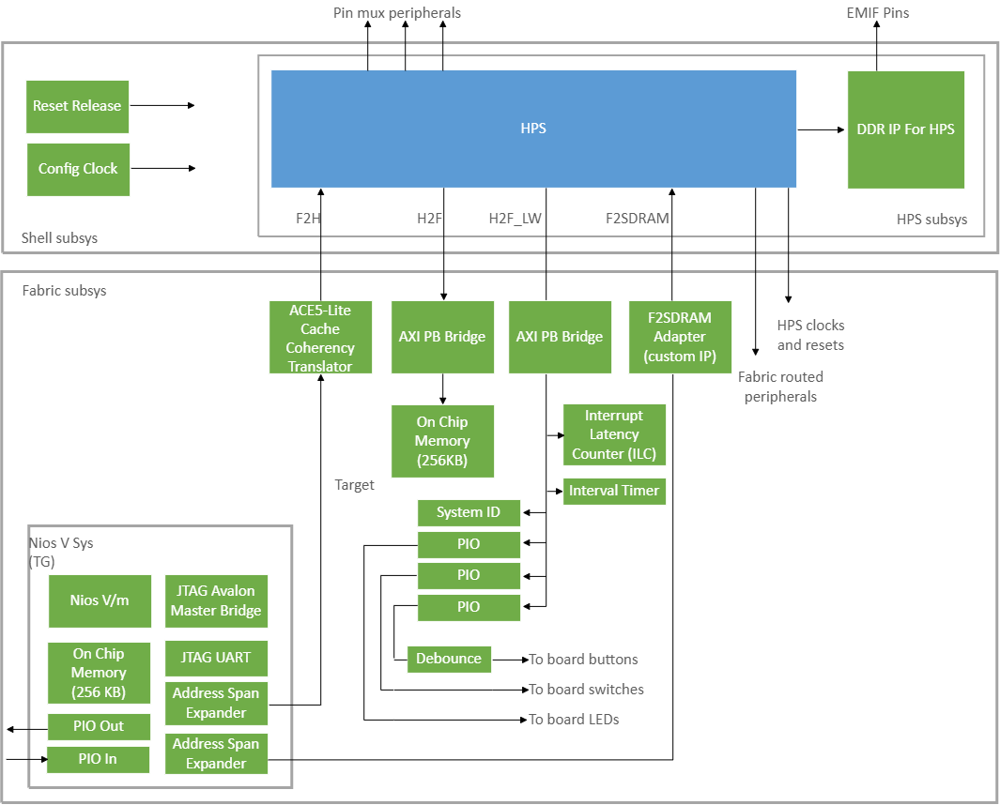
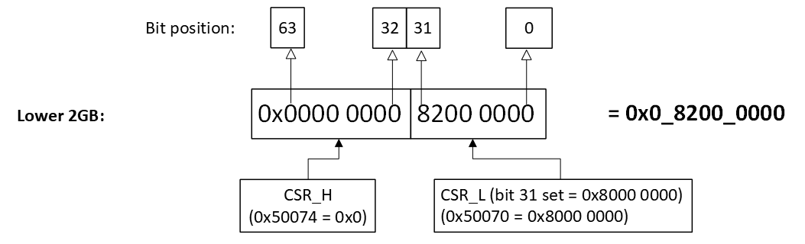
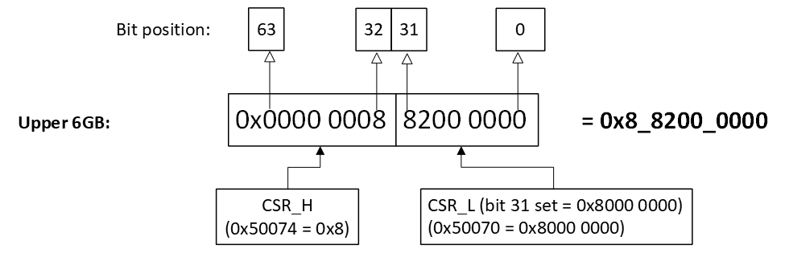

# HPS Time-Sensitive Network (RGMII from HVIO) System Example Design with HPS Expansion Board for Agilex 5 FPGA E-Series 065B Premium Development Kit (ES)

Time-Sensitive Networking (TSN): PHY configuration 2 (RGMII from FPGA HVIO) System Example Design for Agilex 5 FPGA E-Series 065B Premium Development Kit with Out of Box Experience (OOBE) daughter card, which is also known as HPS Enablement Expansion Board.

## Description

</p><p>This is a hardware reference design for Altera Agilex 5 System On Chip (SoC) FPGA and it is part of the HPS Baseline System Example Design (formerly known as GSRD or Golden System Reference Design) that exercises soft IP in the fabric, boots to U-Boot, then Linux, and runs sample Linux applications.
Refer to the <a href=\"https://altera-fpga.github.io/latest/embedded-designs/agilex-5/e-series/premium/gsrd/ug-gsrd-agx5e-premium/">Agilex 5 E-Series Premium Development Kit HPS Baseline System Example Design</a> for information about this design.

</p><p>The design uses HPS First configuration mode and boots from Arm Cortex-A55 core processor.

</p><h2>Time-Sensitive Networking (TSN): PHY configuration 2 (RGMII from FPGA HVIO) feature
</h2><p>This reference design demonstrates the following system integration between Hard Processor System (HPS) and FPGA IPs:
<ul><li>Hard Processor System (HPS) enablement and configuration
<ul><li>Enable dual core Arm Cortex-A76 processor
</li><li>Enable dual core Arm Cortex-A55 processor
</li><li>HPS Peripheral and I/O (SD/MMC, EMAC, MDIO, USB, I3C, JTAG, UART, and GPIO)
</li><li>HPS Clock and Reset
</li><li>HPS FPGA Bridge and Interrupt
<ul><li>Note: The System MMU port in F2H and F2SDRAM bridges are disabled by default</li></ul>
</li></ul><li>HPS EMIF configuration (starting 25.1.1 ECC is enabled by default)
</li><li>System integration with FPGA IPs
<ul><li>GMII to RGMII Converter IP to handle conversion for HPS XGMAC into FPGA HVIO interface.
</li><li>Fabric subsystem that consists of NiosV subsystem, 256KB of FPGA On-Chip Memory, System ID, Programmable I/O (PIO) IP for controlling DIPSW, PushButton, and LEDs.
</li><li>NiosV subsystem that consists of JTAG Avalon Master Bridge IP and Address Span Extender IP to allow System-Console debug activity and FPGA content access through JTAG.

</li></ul></li></ul></p><h3>USB modes
</h3><p>This design supports USB 3.1 in both host and device mode.<br>Once power up, the USB mode will remain and cannot be changed during runtime.

</p><p>The linux device tree (dts) needs to be configured.<br>The dts can be set with &quot;dr_mode&quot;.

</p><table border=\"1\" cellpadding=\"10\" ><tr><th>dr_mode value</th><th>Equivalent USB mode</th></tr>
<tr><td>host</td><td>Host</td></tr>
<tr><td>peripheral</td><td>Device</td></tr></table>

<h2>Advanced feature
</h2><p>FPGA RGMII subsystem that consists of GMII-to-RGMII conversion for HPS XGMAC into FPGA IO connection</p>

## Project Details

- **Family**: Agilex 5 E-Series
- **Quartus Version**: 26.1.1
- **Development Kit**: Agilex 5 FPGA E-Series 065B Premium Development Kit DK-A5E065BB32AES1
- **Device Part**: A5ED065BB32AE6SR0
- **Category**: HPS
- **Source**: Quartus Prime Pro
- **URL**: https://www.github.com/altera-fpga/agilex5e-ed-gsrd
- **Design Package**: dk-a5e065bb32aea-enablement-tsn-rgmii-hvio.zip
- **Documentations**: https://altera-fpga.github.io/latest/embedded-designs/agilex-5/e-series/premium/gsrd/ug-gsrd-agx5e-premium/

## Documentations

- **Title**: HPS Baseline System Example Design User Guide for the Agilex 5 E-Series Premium Development Kit
**URL**: https://altera-fpga.github.io/latest/embedded-designs/agilex-5/e-series/premium/gsrd/ug-gsrd-agx5e-premium/
- **Title**: HPS Time-Sensitive Network (RGMII from HVIO) System Example Design README for the Agilex 5 E-Series Premium Development Kit
**URL**: https://github.com/altera-fpga/agilex5e-ed-gsrd/blob/main/dk-a5e065bb32aes1-enablement/tsn-rgmii-hvio/README.md


## Quartus Design Overview


## Hard Processor System (HPS)
The Quartus Design HPS configuration matches the board schematic.
Refer to [Agilex 5 Hard Processor System Technical Reference Manual](https://docs.altera.com/r/docs/814346/current) and [Hard Processor System Component Reference Manual: Agilex 5 SoCs](https://docs.altera.com/r/docs/813752/current) for more information on HPS configuration.

## HPS External Memory Interfaces (EMIF) DDR
The Quartus Design HPS EMIF DDR configuration matches the board schematic.
Refer to [External Memory Interfaces (EMIF) IP User Guide: Agilex 5 FPGAs and SoCs](https://docs.altera.com/r/docs/817467/current) for more information on HPS EMIF configuration.

## Bridges
Bridges are used to move data between FPGA fabric and HPS logic.
Refer to [HPS Bridges](https://docs.altera.com/r/docs/813752/26.1/hard-processor-system-component-reference-manual-agilextm-5-socs/fpga-bridges).

The HPS address map and the FPGA address map are the same for Agilex 5.
Refer to [Total Address Map Graphical](https://docs.altera.com/r/docs/814346/26.1/hard-processor-system-technical-reference-manual-agilextm-5-socs/total-address-map-graphical) for more information.

Therefore, when accessing HPS logic in uboot or linux, the base address would be the same as, when using [NiosV Subsystem](#niosv-subsystem) from FPGA fabric.

| Bridge   | Use Case |
| :-- | :-- |
| F2SDRAM  | move data from FPGA fabric to HPS logic (non-coherent). Can access HPS EMIF. |
| F2S      | move data from FPGA fabric to HPS logic (coherent). Can access all HPS peripherial except the GIC. |
| LWS2F    | move data from HPS logic to FPGA fabric. Access FPGA peripherial Control Status Register (CSR). |
| H2F      | move data from HPS logic to FPGA fabric. Access FPGA Onchip Memory as scratch pad.    |

## Fabric Subsystem

### NiosV Subsystem
In the NiosV subsystem, the JTAG Avalon Master Bridge IP interface allows access to the peripherals in the FPGA with System Console. This access does not rely on HPS software drivers. Refer to this [Guide](https://docs.altera.com/r/docs/683819/26.1/quartus-prime-pro-edition-user-guide-debug-tools/analyzing-and-debugging-designs-with-system-console) for information about system console.

| NiosV                                | Attribute                    | Addresss Offset                           | Size (bytes)     |
|:-------------------------------------|------------------------------|-------------------------------------------|:----------------:|
| ocm                                  |  On-Chip Memory II           | 0x0                                       | 262144           |
| jtag_uart                            |  JTAG UART                   | 0x0005_0040                               | 8                |
| fpga2hps_address_<br>span_extender   | Address Span Extender        | 0x0005_0070 (cntl)<br>0x4000_0000 (slave) | 8<br>1073741824  |
| f2sdram_address_<br>span_extender    | Address Span Extender        | 0x0005_0080 (cntl)<br>0x8000_0000 (slave) | 8<br>1073741824  |
| pio_in                               | PIO (Parallel I/O) Inputs    | 0x0005_0050                               | 16               |
| pio_out                              | PIO (Parallel I/O) Outputs   | 0x0005_0060                               | 16               |


### SDRAM Access via Address Span Extender (F2SDRAM/F2H Bridge)

#### Overview

The PDK is equipped with **8 GB of SDRAM**, mapped across two physical address regions:

| Region       | Global Address Range                 | Local Address Range                     |
|--------------|--------------------------------------|-------------------------------------------|
| Lower 2 GB   | `0x00_8000_0000` – `0x00_FFFF_FFFF`  | `0x0_0000_0000` – `0x0_7FFF_FFFF`        |
| Upper 6 GB   | `0x08_8000_0000` – `0x09_FFFF_FFFF`   | `0x0_8000_0000` – `0x1_FFFF_FFFF`        |

> **

> **Note:** System Console/Nios V operates in a **32-bit address space** and cannot directly access 64-bit SDRAM addresses. The address `0x9_0200_0000` is an example of a target address in the upper 6GB region.

---

#### Address Span Extender IP

The **Address Span Extender IP (F2SDRAM/F2H Bridge)** resolves this limitation by using two control registers — **CSR_L** and **CSR_H** — to construct a full 64-bit physical SDRAM address from a 32-bit data address.

| Register | Base Address          | Holds                                   |
|----------|-----------------------|-----------------------------------------|
| `CSR_L`  | `0x50070`(F2H)        | Bits `[31:0]` of 64-bit target address  |
| `CSR_H`  | `0x50074`(F2H)        | Bits `[63:32]` of 64-bit target address |
| `CSR_L`  | `0x50080`(F2SDRAM)    | Bits `[31:0]` of 64-bit target address  |
| `CSR_H`  | `0x50084`(F2SDRAM)    | Bits `[63:32]` of 64-bit target address |

Together, **CSR_H** and **CSR_L** define the physical SDRAM region that the 32-bit data address window points to.

#### How the Address Span Extender Works — The "Sliding Window" Concept

Think of the Address Span Extender like a **sliding window** cut into a wall:

- The **wall** represents the full 8 GB SDRAM — too large to see all at once.
- The **window** is a fixed **1 GB opening** (`0x0` to `0x4000_0000` in internal offset) that you can look through at any one time.
- The **CSR registers** are the handle you use to **slide the window** to point at any part of the 8 GB SDRAM.

In this design, the 1 GB window (windowed_slave) is placed at address from `0x8000_0000` to `0xbfff_ffff` (F2SDRAM) `0x4000_0000` to `0x7fff_ffff` (F2H) in the address_span_extender IP, covering exactly 2²⁸ × 4 = **1 GB** of addressable space through a 28-bit word address.

#### Sliding the Window — When to Shift CSR_L

For F2SDRAM as example, `CSR_L` is set to `0x8000_0000`, which anchors the window at `0x8000_0000` and allows System Console to read addresses from `0x8000_0000` to `0xBFFF_FFFF`. If your target SDRAM address exceeds this 1 GB window (i.e. the lower 32 bits of your target address is greater than `0xBFFF_FFFF`), you need to **slide the window** by updating `CSR_L` to the next 1 GB aligned boundary. Set `CSR_L` to `0xC000_0000`, which shifts the window to cover `0xC000_0000` to `0xFFFF_FFFF`. The System Console read address then starts from `0xC000_0000` onwards for that new window.

---

#### How to Perform a Read via System Console

**Step 1 — Set the CSR registers** before reading:
- Write the **lower 32 bits** of the target SDRAM address to `CSR_L` at `0x50070` (F2H).
- Write the **upper 32 bits** of the target SDRAM address to `CSR_H` at `0x50074` (F2H).
- Write the **lower 32 bits** of the target SDRAM address to `CSR_L` at `0x50080` (F2SDRAM).
- Write the **upper 32 bits** of the target SDRAM address to `CSR_H` at `0x50084` (F2SDRAM).

**Step 2 — Compute the data address:**

Compute_address = F2SDRAM Address Span Extender IP window slave address (0x8000_0000) + offset from target address
Compute_address = F2H Address Span Extender IP window slave address (0x4000_0000) + offset from target address

**Step 3 — Read from the computed data address** in System Console.

---

#### Example Target Address

> **
> *Figure 1: F2SDRAM Lower 2GB Example*

| Target Address | CSR_H | CSR_L       | F2SDRAM address span extender window slave address + offset |
|----------------|-------|-------------|-------------------------------------------------------------|
| 0xC200_0000    | 0x0   | 0xC000_0000 | 0x8000_0000 (f2sdram) + 0x0200_0000 = 0x8200_0000           |

> **
> *Figure 2: F2SDRAM Upper 6GB Example*

| Target Address | CSR_H | CSR_L       | F2SDRAM address span extender window slave address + offset |
|----------------|-------|-------------|-------------------------------------------------------------|
| 0x9_0200_0000  | 0x9   | 0x0000_0000 | 0x8000_0000 (f2sdram) + 0x0200_0000 = 0x8200_0000           |

> **
> *Figure 3: F2H Lower 2GB Example*

| Target Address | CSR_H | CSR_L       | F2H address span extender window slave address + offset     |
|----------------|-------|-------------|-------------------------------------------------------------|
| 0x8200_0000    | 0x0   | 0x8000_0000 | 0x4000_0000 (f2h) + 0x0200_0000 = 0x4200_0000               |

> **
> *Figure 4: F2H Upper 6GB Example*

| Target Address | CSR_H | CSR_L       | F2H address span extender window slave address + offset     |
|----------------|-------|-------------|-------------------------------------------------------------|
| 0x8_8200_0000  | 0x8   | 0x8000_0000 | 0x4000_0000 (f2h) + 0x0200_0000 = 0x4200_0000               |

---

#### Key Takeaway

> The **System Console input address (master_address)** is always derived from the **base address of the Address Span Extender IP window** plus the **offset extracted from the lower 32 bits of the target address**, regardless of which SDRAM region you are accessing.

> In summary: **`CSR_H` selects the SDRAM bank, `CSR_L` slides the window within that bank, and the master_address is always base_address + offset from the target address.**

### Peripherals
| Peripheral | Address Offset | Size (bytes) | Attribute | Interrupt Number
| :-- | :-- | :-- | :-- | :-- |
| sysid | 0x0001_0000 | 8 | Unique system ID   | None |
| led_pio | 0x0001_0080 | 16 | LED outputs   | None |
| button_pio | 0x0001_0060 | 16 | Push button inputs | 0 |
| dipsw_pio | 0x0001_0070 | 16 | DIP switch inputs | None |

#### Notes
- There are 4 user DIP switch inputs, 4 user push-button inputs and 4 LED outputs that is connected to fpga pins on Agilex 5 FPGA E-Series 065B Premium Development Kit.
  -  Only the lower three bits of LED outputs are available for software to control. The most significant bit of the LED is used in Quartus Design top module as heartbeat led. This LED blinks when the fpga design is loaded. Users will not be able to control this LED with HPS software, for example U-Boot or Linux.
- The peripheral components in fabric subsystem can be accessed via the LWS2F bridge and have offset of 0x0_2000_0000. Refer to [Total Address Map Graphical](https://docs.altera.com/r/docs/814346/26.1/hard-processor-system-technical-reference-manual-agilextm-5-socs/total-address-map-graphical).
- The FPGA IRQ has offset of 17 when mapped to Generic Interrupt Controller (GIC) in device tree structure(dts). Refer to fpga2hps_interrupt_irq0[0] in [GIC Shared Peripheral Interrupts Map for the SoC HPS](https://docs.altera.com/r/docs/814346/26.1/hard-processor-system-technical-reference-manual-agilextm-5-socs/gic-shared-peripheral-interrupts-map-for-the-soc-hps).

## Binaries location
After build, the bitstream (sof) can be found in output_files folder.

## Generating FPGA Fabric Configuration (Core RBF)
After the sof is generated, the following command can be run to generate the core.rbf.
```bash
make tsn_rgmii_hvio-install-core-rbf
```
The generated core.rbf can be found in install/binaries folder.

# Yocto Build Setup Guide
1. Refer to [Yocto Linux Build Instructions](software/yocto_linux/README.md#yocto-build) file and follow the steps to build Yocto.

After build, the binaries can be found in the software/yocto_linux_sd or software/yocto_linux_qspi folder.